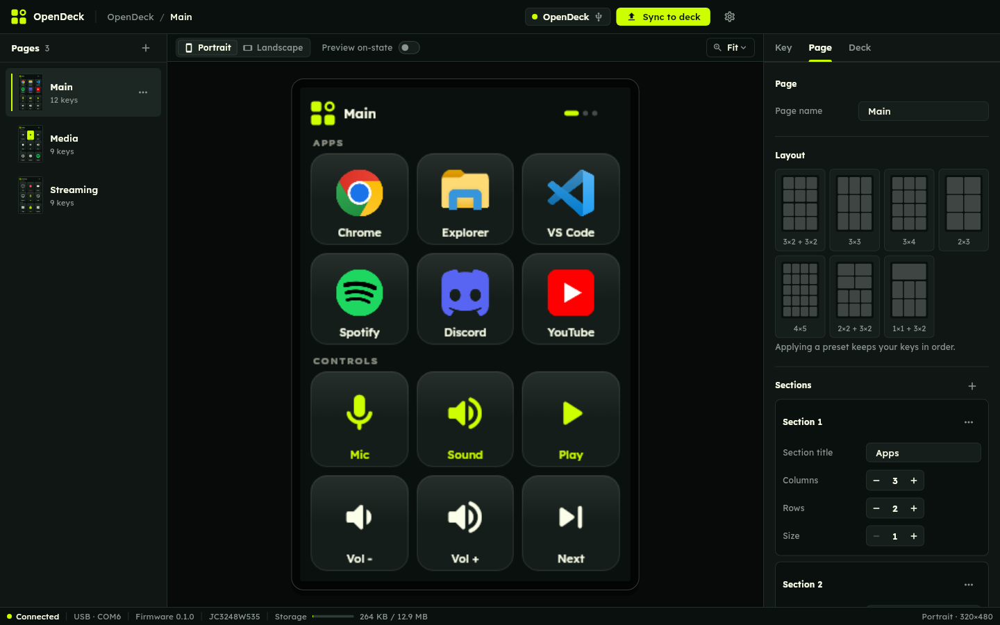
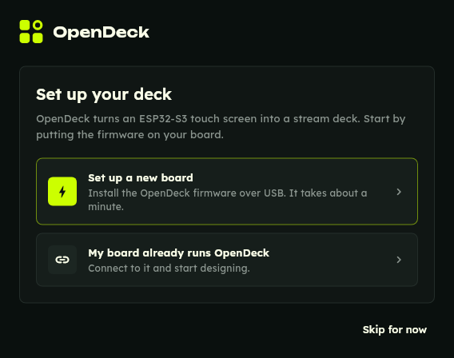
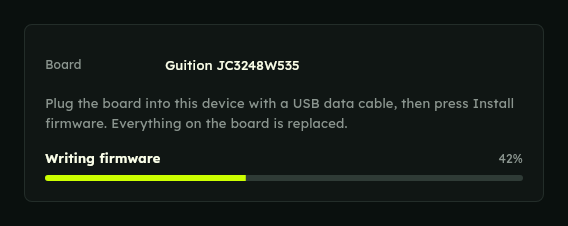
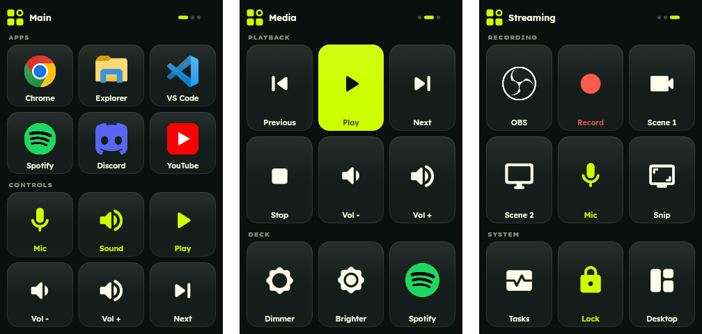

<p align="center">
  
</p>

<h1 align="center">OpenDeck</h1>

<p align="center">
  An open source stream deck you build from a cheap ESP32 touch screen.<br>
  Design your keys in the app, sync them over USB or Wi-Fi, and tap away.
</p>

<p align="center">
  <a href="LICENSE"></a>
  <a href="https://github.com/Introvert-Programmer-Lab/opendeck/releases/latest"></a>
  <a href="https://github.com/Introvert-Programmer-Lab/opendeck/actions/workflows/ci.yml"></a>
</p>

<p align="center">
  
</p>

## Get started

You do not need to install any developer tools. Three steps:

**1. Get a board.** OpenDeck runs on [18 popular ESP32 touch screens](#supported-boards), from the 2.8 inch "Cheap Yellow Display" you find on Temu and Amazon for a few dollars to 7 inch 800x480 panels. The best tested one is the 3.5 inch **Guition JC3248W535C** ([Amazon](https://www.amazon.com/dp/B0DGXRZ58V)). The [board table](#supported-boards) has a buy link for each board. You also need a USB cable that carries data (not a charge-only one).

**2. Get the app.** Download it from the [latest release](https://github.com/Introvert-Programmer-Lab/opendeck/releases/latest):

- **Windows 10 or 11:** `OpenDeck-<version>-windows-x64-setup.exe`, an installer that needs no admin rights. A portable `.zip` is there too.
- **Android:** not available yet, see below.

> [!NOTE]
> **No Android app for now.** The Android build is paused: the USB serial library the app uses does not build with the current Android build tools. The Android code stays in the repository and the app will come back once that is fixed. Until then, use the Windows app.

**3. Install the firmware.** Plug the board in, open the app and pick **Set up a new board**, then **Install firmware**. That one click is the whole install: the app finds the board, works out which model it is, writes the matching firmware, checks it and restarts the board. It takes about a minute.

If the board is not one OpenDeck has firmware for, the app says so and writes nothing. The 4.3", 5" and 7" 800x480 boards use the same chips, so for those it asks which model is printed on the back.

> [!WARNING]
> **Colors look like a photo negative?** Many cheap screens come with one of two panel types that look identical from the outside, and some have their colors inverted with the default setting. Nothing is broken. Open the deck settings in the app and turn on **Invert colors**. The board restarts with the right colors and remembers the setting.

<p align="center">
  
  
</p>

If the app cannot reach the board, try another cable, or hold **BOOT**, tap **RST**, let go of BOOT and press Install again.

Changed your mind? On the JC3248W535, **Restore factory firmware** on the same screen puts back the demo program the board shipped with, also in one click. See [docs/BOARDS.md](docs/BOARDS.md#factory-firmware).

Once the board restarts it shows the default deck and the app connects to it on its own. To use it without a cable, open the deck panel in the app and send it your Wi-Fi name and password.

## What it does

OpenDeck turns the touch screen into a grid of keys. Each key has an icon, a label, colors and an action. The board is also a USB keyboard, so the basics work with no app running at all.

**On the board, with no app**
- Media keys: play, pause, next, previous, volume, mute.
- Keyboard shortcuts, like `ctrl+shift+m` or `win+d`.
- Typing a piece of text (plain ASCII, US keyboard layout).
- Swipe left and right to change pages, swipe down for connection info (Wi-Fi name and IP address).

**With the desktop app open** (it lives in the system tray)
- Open apps, files, folders and websites. Like a taskbar button, an app that is already open comes to the front (restored if it was minimized) instead of opening again, and pressing it again cycles through its windows. Turn off **Switch to it if already open** on a key to get a new window every time.
- Run commands.
- Real system mute for the microphone and speakers, with the key showing the current state.
- Pick from the apps installed on your PC, with their real icons.

**In the editor**
- Pages with one or more grids, presets for common layouts, portrait or landscape.
- Thousands of icons: Material symbols, official brand logos from [Simple Icons](https://simpleicons.org), full-color app icons from [Dashboard Icons](https://github.com/homarr-labs/dashboard-icons), or your own images.
- Toggle keys with a second look for the "on" state.
- Background colors and images, key colors, corner radius, spacing and label size.
- English and Arabic, including right-to-left layout.

<p align="center">
  
</p>

## How it works

The app does the heavy lifting. It renders every page to a finished JPEG at the panel's resolution, with icons, labels, Arabic shaping, backgrounds and rotation already applied. It then uploads those images with a small manifest (`deck.json`) that lists where each key is and what the board should do on its own when it is tapped.

```mermaid
sequenceDiagram
    autonumber
    actor You
    participant App as OpenDeck app
    participant Board as Board

    App->>App: render pages to JPEG
    App->>Board: deck.json + page images (USB or Wi-Fi)
    Board->>Board: decode the current page
    You->>Board: tap a key
    alt desktop app connected
        Board->>App: key event
        App->>App: run the action (open app, mute mic, ...)
        App-->>Board: toggle state
    else no app
        Board->>Board: send keys or media keys over USB HID
    end
```



The board only has to blit images and report touches, so the firmware is small and runs on anything from a plain ESP32 with no PSRAM (which draws the page in strips straight from flash) to an ESP32-S3 driving an 800x480 RGB panel. Pages are compressed with a JPEG quality you choose. With auto quality on, the app lowers the quality step by step until the deck fits the board's free storage. The default deck is about 190 KB.

The wire protocol is line-delimited JSON over USB serial or TCP, described in [docs/PROTOCOL.md](docs/PROTOCOL.md).

## Supported boards

Eleven board families, eighteen models. The app detects which one is plugged in.

| Screen | Models | Chip | Touch | USB keyboard | Buy |
|---|---|---|---|---|---|
| 3.5" 320x480 | **Guition JC3248W535C** (tested) | ESP32-S3 | capacitive | yes | [Amazon](https://www.amazon.com/dp/B0DGXRZ58V) |
| 2.8" 240x320 | ESP32-2432S028R ("Cheap Yellow Display"), ESP32-2432S028R 2 USB (USB-C + micro-USB), ESP32-2432S028R v3 | ESP32 | resistive | no | [Temu (2 pack)](https://www.temu.com/2-sets-of-esp32-development-boards-with-2-8-inch-240-320-resolution-lcd-display-tft-module-with--semiconductor-product-circuit-board-prototype-g-606476089325517.html), [Amazon](https://www.amazon.com/dp/B0CKYVPWX9) |
| 2.8" 240x320 | Guition JC2432W328C | ESP32 | capacitive | no | [Amazon](https://www.amazon.com/dp/B0D5H84RDB) |
| 2.8" 240x320 | LCDWIKI ES3C28P (Hosyond ESP32-S3 2.8") | ESP32-S3 | capacitive | yes | [Amazon](https://www.amazon.com/dp/B0FKG7WRWV) |
| 2.4" 240x320 | ESP32-2432S024C, ESP32-2432S024R | ESP32 | capacitive / resistive | no | [Amazon](https://www.amazon.com/dp/B0CLGD2DG6), [2 pack](https://www.amazon.com/dp/B0DC6DV88F) (C) |
| 3.2" 240x320 | ESP32-2432S032C | ESP32 | capacitive | no | [Amazon](https://www.amazon.com/dp/B0CLGDHS16) |
| 3.5" 320x480 | ESP32-3248S035C, ESP32-3248S035R | ESP32 | capacitive / resistive | no | [Amazon](https://www.amazon.com/dp/B0C4KSKW96) (C) |
| 4.3" 480x272 | Guition JC4827W543C | ESP32-S3 | capacitive | yes | search the model number |
| 4.3" 480x272 | ESP32-4827S043C | ESP32-S3 | capacitive | no | search the model number |
| 4.3" / 5" 800x480 | ESP32-8048S043C, ESP32-8048S050C, Guition JC8048W550C | ESP32-S3 | capacitive | no | [Amazon 4.3"](https://www.amazon.com/dp/B0CLGCMWQ7), [Amazon 5"](https://www.amazon.com/dp/B0DRYS8ZTW) |
| 7" 800x480 | ESP32-8048S070C | ESP32-S3 | capacitive | no | search the model number |
| 4" 480x480 | Guition ESP32-4848S040C | ESP32-S3 | capacitive | no | search the model number |

Only the JC3248W535 has been run on real hardware so far. The others are built from their published pinouts; reports are welcome. Boards marked "no" under USB keyboard reach the chip through a CH340 or CP2102 bridge, so their keys act through the app (over USB or Wi-Fi) rather than as a keyboard.

Resistive boards (the R models) ask you to tap three crosshairs the first time they start, so taps land where you touch. You can redo it any time from the app (**Calibrate touch** in the deck panel) or by holding a finger on the screen for 5 seconds.

Links go to the cheapest listing found for each board, Temu first where it has one. For boards without a link, search Temu or AliExpress for the model number. [docs/BOARDS.md](docs/BOARDS.md) has what to check before ordering, how detection works and how to add a board.

## Building from source

| Part | What you need | Start here |
|---|---|---|
| App | Flutter stable (3.44 or newer) | `flutter pub get`, then `flutter run -d windows` (or `macos`, `linux`) |
| Firmware | ESP-IDF 5.5 | `idf.py -DOPENDECK_BOARD=<board> build` in `firmware/` |

### Firmware

On Linux or macOS:

```
. ~/esp/esp-idf/export.sh
cd firmware
idf.py -B build/esp32-2432s028r -DOPENDECK_BOARD=esp32-2432s028r build
idf.py -B build/esp32-2432s028r -p /dev/ttyUSB0 flash
```

The board names are the folders in `firmware/boards/`. Without `OPENDECK_BOARD` the build is for the JC3248W535.

On Windows, `tools/idf.ps1` finds ESP-IDF (in `C:\Espressif\frameworks`, `~/esp`, or the folder in `OPENDECK_IDF_PATH`) and runs `idf.py` with it:

```
powershell -ExecutionPolicy Bypass -File tools\idf.ps1 build
powershell -ExecutionPolicy Bypass -File tools\flash.ps1          # app only, keeps your deck
powershell -ExecutionPolicy Bypass -File tools\flash.ps1 -All     # bootloader, app and default deck
```

`flash.ps1` asks a running deck to restart into the ROM bootloader, waits for the USB-Serial/JTAG port and flashes, so no buttons are needed.

To test a local build with the app's installer, make a merged image and pick it with **Use a firmware file**:

```
cd firmware/build/esp32-2432s028r
python -m esptool --chip esp32 merge_bin -o opendeck-esp32-2432s028r.bin @flash_args
```

### Testing without a board

`firmware/boards/qemu-esp32` and `qemu-esp32s3` are virtual boards for Espressif's QEMU. They run the shared firmware with the display replaced by a pixel copy and taps fed in over the protocol. `tools/qemu_test.py` boots one and checks that storage mounts, the default deck loads, the drawn page matches what the app rendered, page switching and taps work, and a fill reaches every pixel. CI runs it on every push.

```
python $IDF_PATH/tools/idf_tools.py install qemu-xtensa
cd firmware
idf.py -B build/qemu-esp32 -DOPENDECK_BOARD=qemu-esp32 build
cd build/qemu-esp32
python -m esptool --chip esp32 merge_bin --fill-flash-size 4MB -o flash.bin @flash_args
cd ../../..
python tools/qemu_test.py firmware/build/qemu-esp32 esp32
```

QEMU covers the shared code, not the panels: display and touch drivers, timings and color order still need the real board.

### Generated files

```
uv run --with pillow python tools/gen_logo.py                 # logo, app icons, tray icons
uv run --with pillow python tools/gen_firmware_assets.py      # boot splash and bitmap fonts
OPENDECK_EXPORT=1 flutter test test/default_deck_export_test.dart   # default deck for each screen size
```

### Releases

Pushing a tag like `v0.2.0` runs [`.github/workflows/release.yml`](.github/workflows/release.yml). It builds the firmware for every board, merges each into one image, bundles those images into the Windows app (so first-time setup works offline) and publishes everything to a GitHub release. Builds without a bundled image download it from the latest release.

### Tools

- `tools/deck_probe.py COM6 '{"t":"hello"}'` sends raw protocol commands and prints the replies.
- `tools/deck_push.py COM6 <folder>` uploads a deck folder.

## Project layout

```
lib/                 Flutter app
  core/services/     USB and Wi-Fi link, discovery, host actions, firmware flasher and board detection
  features/deck/     editor, renderer and deck compiler
  features/onboarding/  first-run setup and firmware install
firmware/            ESP-IDF firmware
  main/              deck logic, rendering, USB or UART link, Wi-Fi, protocol
  main/drivers/      shared display, touch and backlight drivers
  boards/            one folder per board: pins, panel init, build settings
  fs_image/          default deck for each screen size, baked into the storage partition
tools/               asset generators and helper scripts
docs/                protocol notes and README assets
```

## License

Code is MIT licensed, see [LICENSE](LICENSE). Bundled fonts (Lexend, Unbounded, Alexandria) are under the SIL Open Font License (`assets/fonts/OFL-*.txt`). Icon sets keep their own licenses, in `assets/icons/`.
